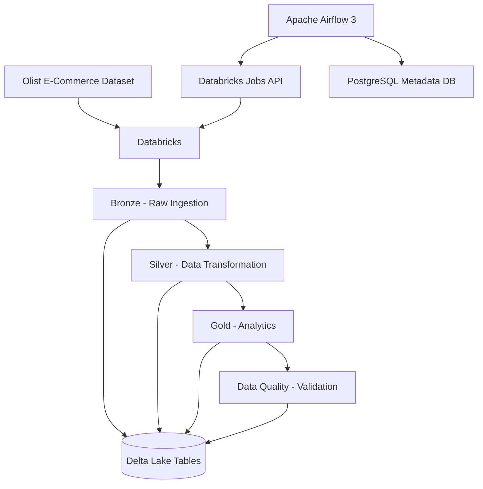
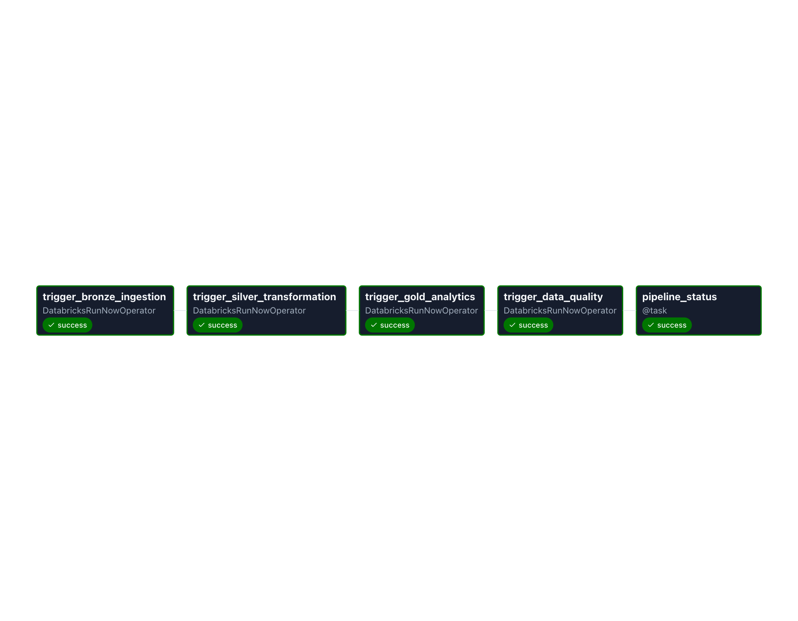
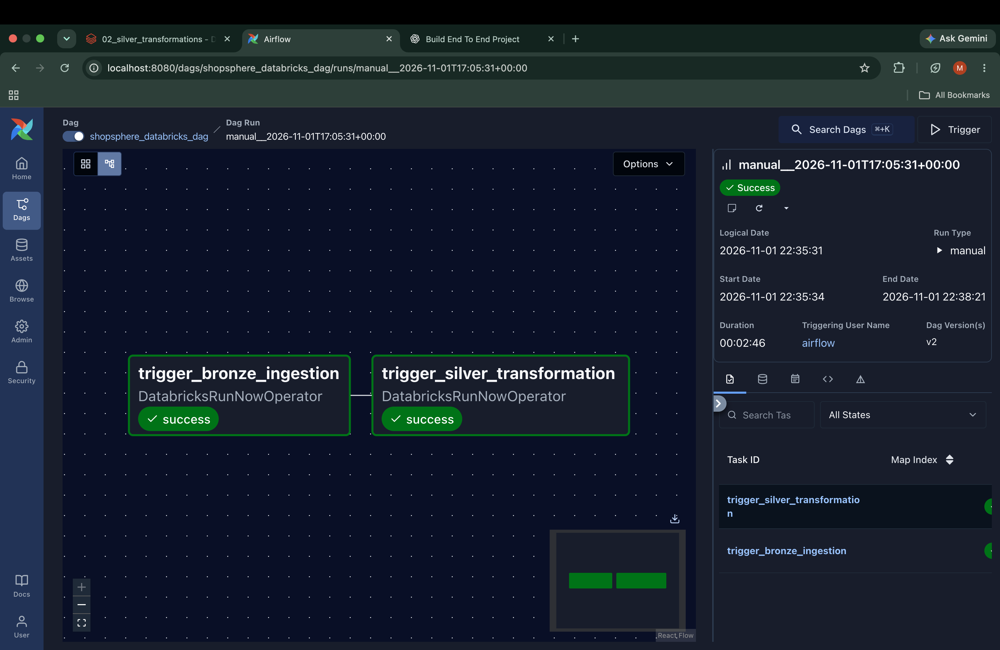
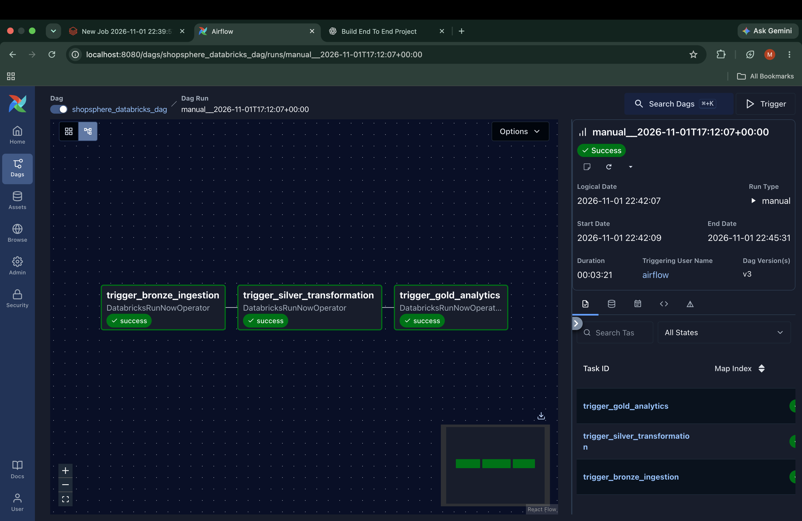
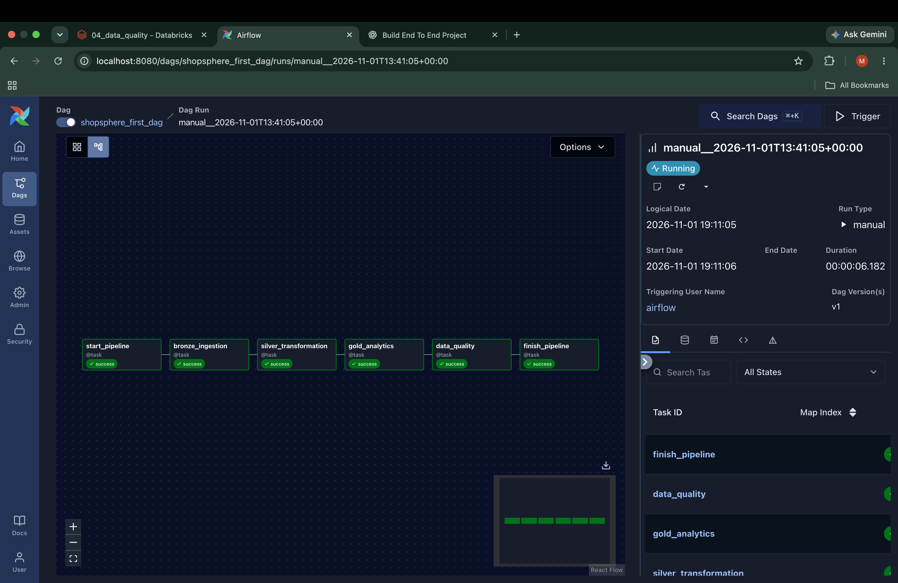

# ShopSphere — End-to-End E-Commerce Data Engineering Pipeline

An end-to-end data engineering project built with **PySpark, Databricks, Delta Lake, and Apache Airflow**, using the Brazilian E-Commerce Public Dataset by Olist.

ShopSphere transforms raw e-commerce data into analytics-ready datasets using Medallion Architecture and automates pipeline execution through Apache Airflow.

---

## Architecture




Databricks Medallion Architecture Explained | Unlocking Business Value


## Project Screenshots

### 1. Airflow Pipeline Orchestration


### 2. Bronze Layer


### 3. Silver Layer


### 4. Gold Layer


### 5. Data Quality Validation


## Technology Stack

| Technology | Purpose |
|---|---|
| Python | Programming |
| PySpark | Distributed data processing |
| Databricks Free Edition | Data engineering platform |
| Delta Lake | Reliable data storage |
| Apache Airflow 3 | Workflow orchestration |
| Docker Compose | Local Airflow deployment |
| PostgreSQL | Airflow metadata storage |
| Git & GitHub | Version control |

## Dataset

**Brazilian E-Commerce Public Dataset by Olist**

Source: https://www.kaggle.com/datasets/olistbr/brazilian-ecommerce

The dataset contains Brazilian e-commerce orders, customers, order items, products, and related information.

## Medallion Architecture

### 1. Bronze Layer — Raw Ingestion

- Ingested raw CSV datasets into Databricks.
- Created Delta tables.
- Added ingestion timestamp and source metadata.

Tables:
- `workspace.shopsphere.bronze_orders`
- `workspace.shopsphere.bronze_customers`
- `workspace.shopsphere.bronze_order_items`

### 2. Silver Layer — Data Transformation

- Removed duplicate records.
- Handled null values in important fields.
- Standardized city and state values.
- Converted date columns to timestamps.
- Applied appropriate numeric data types.
- Validated primary business keys.

Tables:
- `workspace.shopsphere.silver_orders`
- `workspace.shopsphere.silver_customers`
- `workspace.shopsphere.silver_order_items`

### 3. Gold Layer — Analytics

Created analytical datasets for business insights.

**Daily Revenue**
- Daily revenue
- Number of distinct orders
- Freight analysis

**Product Performance**
- Units sold
- Total orders
- Product revenue
- Average selling price

**Customer Summary**
- Total orders
- Customer spending
- Average order value
- Customer location

Tables:
- `workspace.shopsphere.gold_daily_revenue`
- `workspace.shopsphere.gold_product_performance`
- `workspace.shopsphere.gold_customer_summary`

### 4. Data Quality

Implemented validation checks for:
- Null values in important columns
- Duplicate business keys
- Record counts
- Revenue reconciliation between Silver and Gold data

## Data Quality Results

| Dataset | Rows |
|---|---:|
| Bronze Orders | 99,441 |
| Silver Orders | 99,441 |
| Silver Customers | 99,441 |
| Silver Order Items | 112,650 |
| Gold Daily Revenue | 612 |
| Gold Product Performance | 32,951 |
| Gold Customer Summary | 96,478 |

**Revenue reconciliation**

| Metric | Amount |
|---|---:|
| Expected revenue | 13,221,498.11 |
| Gold revenue | 13,221,498.11 |
| Difference | 0.00 |

Result: PASS

*Revenue values are in the dataset's currency (Brazilian real, BRL).*

## Workflow Orchestration — Apache Airflow

Apache Airflow orchestrates Databricks Jobs through the Databricks Jobs API.

Execution sequence:

`Bronze → Silver → Gold → Data Quality`

Implemented features:

- Sequential task dependencies
- Databricks Job triggering
- Automatic retries (2 retries per task)
- Daily scheduling (02:00 UTC)
- Log-based pipeline status monitoring
- Failure and upstream-failure tracking

Airflow runs locally through Docker Compose, while PySpark processing runs in Databricks.

## Repository Structure

```text
ShopSphere/
│
├── airflow/
│   └── dags/
│       └── shopsphere_databricks_dag.py
│
├── databricks/
│   ├── 01_bronze_ingestion.py
│   ├── 02_silver_transformations.py
│   ├── 03_gold_analytics.py
│   └── 04_data_quality.py
│
├── docs/
│   └── architecture.md
│
├── screenshots/
│
├── .gitignore
└── README.md
```

## Setup and Execution

### 1. Databricks

- Create a Databricks workspace.
- Import the four notebooks from the `databricks/` directory.
- Configure the required compute.
- Create four Databricks Jobs for Bronze, Silver, Gold, and Data Quality.
- Configure the `workspace.shopsphere` catalog and schema.

### 2. Apache Airflow

- Install Docker Desktop.
- Deploy Airflow using Docker Compose.
- Install the Databricks Airflow provider.
- Configure the `databricks_default` connection.
- Add your Databricks Job IDs to the Airflow DAG.

### 3. Run the Pipeline

Trigger `shopsphere_databricks_dag` manually or use its configured daily schedule.

**Security:** Configure credentials through Airflow Connections. Never commit personal access tokens, passwords, or secret environment files.

## Screenshots

Screenshots of the following will be added:

- [ ] Complete Airflow DAG Graph view
- [ ] Successful Airflow task execution
- [ ] Databricks Bronze tables
- [ ] Databricks Silver tables
- [ ] Databricks Gold tables
- [ ] Data quality validation results

## Future Improvements

- External failure notifications
- Advanced monitoring and observability
- Incremental data processing
- CI/CD automation
- Automated deployment of Databricks notebooks

---

**ShopSphere — Turning raw e-commerce data into actionable analytics.**